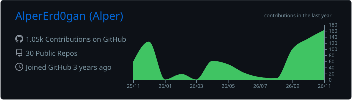

<!-- Animated header -->

<!-- Typing animation -->

  

---

## What I Do

- Building **multi-agent assistants** with RAG and LLM tool calling
- Designing **data pipelines** — Lakehouse, batch & streaming, ETL
- Training **ML / CV models** with PyTorch & TensorFlow

---

## 🛠️ Tech Stack

  

  
  
  
  
  
  

---

  

<picture>
  <source media="(prefers-color-scheme: dark)" srcset="https://raw.githubusercontent.com/AlperErd0gan/AlperErd0gan/output/github-contribution-grid-snake-dark.svg">
  
</picture>

🏀 Basketball · 🎬 Cinema · 🎨 Art · 🎮 Gaming

<!-- Animated footer -->

